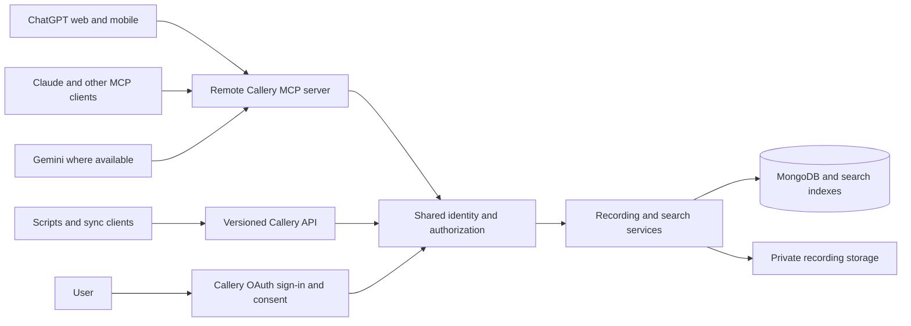

# AI agent integration plan

**Status:** Draft for discussion; no implementation or public submission is implied by this document.\
**Last updated:** 2026-11-07\
**Working product name:** Callery (the existing API and some deployment documentation use Vosift).

This is a living plan. Proposed behavior and decisions below are not current product capabilities unless explicitly identified as existing. Update the decisions, scope, platform checks, and release gates as the plan evolves.

## Goal

Let a person connect their Callery account to an AI assistant and ask it to find recordings by describing a conversation, the people involved, and an approximate date. The assistant should return useful evidence and a link to each recording, without accessing data outside the user's grant.

The distribution goal is **publicly discoverable Callery integrations for ChatGPT, Claude, and Gemini**, using ordinary web and mobile conversations where each platform makes them available. ChatGPT web and Android are an explicit priority; Claude and Gemini each have their own distribution and release gates. The shared service should also support other compatible agents. Callery's API must remain useful to non-MCP clients, including upload and sync integrations.

### Example

> Find my calls with Priya where we talked about moving the delivery date to next week.

The assistant searches the user's authorized recordings and returns likely matches with dates, contact information, timestamped transcript excerpts where available, and links back to Callery. It must not represent a name mentioned in a transcript as a verified speaker. If participant identity, transcript coverage, or relevance is uncertain, the response should make that clear.

### Success outcomes

- A user can connect their own Callery account through a clear consent flow, search from normal ChatGPT chat, and revoke the connection independently.
- Search uses transcript evidence as well as summaries and keywords, and provides sufficient context for the assistant to explain a result.
- The same core API and remote MCP server can be used by other supported clients without a separate implementation of access control.
- Authorized clients can eventually upload recordings and request transcription, with the appropriate separate permissions and a verified file-transfer path.
- A public ChatGPT release is evaluated on real web and Android flows, security, search relevance, operational readiness, and platform review—not just a local demonstration.
- Claude and Gemini have explicit private test, public distribution, and web/mobile validation plans. A delay or eligibility restriction on one platform does not imply that the others are blocked.

## Platform and distribution targets

These statements reflect documentation checked on 2026-11-07. Recheck requirements and availability before implementation and submission; client behavior, plans, regions, and review rules can change.

| Platform | Intended path | Known constraints and validation |
| --- | --- | --- |
| ChatGPT web | Hosted remote MCP server, OAuth, and a publicly listed plugin; use a custom private connection for development. | OpenAI documents custom MCP creation on the web. Public distribution requires a separate submission and approval. |
| ChatGPT Android | Use the public, non-desktop-only plugin in ordinary ChatGPT chat. | OpenAI documents mobile use of plugins available to an account. It does not establish every Android installation and onboarding path; test installation, sign-in, search, links, and reconnection on a real Android client. Web installation may be necessary for some users. |
| Claude web and mobile | Remote custom connector for testing, then a directory connector or plugin backed by the same MCP server and OAuth. | Claude documents remote connectors across its surfaces and fixed-header credentials for some custom connectors. Availability and administrative controls vary; test onboarding and use on real devices. |
| Gemini web and mobile | Remote MCP custom connected app for testing, then pursue a reviewed Connected App backed by the same core services. | Google currently restricts consumer **custom** apps to eligible US adults using personal Google accounts, in English, with activity enabled. These custom-app conditions must not be assumed to describe all reviewed Connected Apps. Verify public-program eligibility and availability separately. |
| Other agents | Streamable HTTP MCP, or the versioned HTTP API where MCP is unavailable. | Compatibility and authentication must be tested client by client. |

Sources: [ChatGPT plugins](https://learn.chatgpt.com/docs/plugins), [custom MCP connection](https://developers.openai.com/api/docs/guides/custom-mcp-server), [public plugin submission](https://developers.openai.com/plugins/deploy/submission), [Claude custom connectors](https://support.claude.com/en/articles/11175166-get-started-with-custom-connectors-using-remote-mcp), and [Gemini custom connected apps](https://support.google.com/gemini/answer/17209137).

### Platform-specific distribution tracks

The shared service is one product component; platform packaging, registration, approval, and availability are separate deliverables. Maintain a release checklist and a status of **not tested**, **passed**, **failed**, or **blocked by eligibility** for each target.

| Track | Private development and testing | Public distribution target | Release gate |
| --- | --- | --- | --- |
| ChatGPT | Register a private custom MCP connection on the web; test normal chat and Android use with a test account. | Submit the Callery plugin to the public directory using the platform's current process. | Verified developer identity, public HTTPS service, review materials and sample account, policy checks, approval, and owner-directed publication. |
| Claude | Register the remote MCP server as a custom connector; test ordinary chat on web and mobile. | Apply for a public connector directory listing; assess a plugin package only if it improves discovery or workflows. | Current directory eligibility, developer and review requirements verified, successful OAuth and tool tests, approval, and owner-directed release. |
| Gemini | Register a custom MCP app or use the available developer test workflow from an eligible account; validate web and mobile use. | Register the service with Google Connected Console and pursue review as a Connected App. | Confirm account/program and category eligibility, domain ownership, required metadata, OAuth, testers, review, and actual product/region availability. |

Claude describes [remote connectors](https://support.claude.com/en/articles/11725091-when-to-use-desktop-and-web-connectors) as usable across its surfaces and allows plugins to bundle them. Its [connector submission guide](https://claude.com/docs/connectors/building/submission) currently requires a paid Claude account to submit and Verified status before publishing a multi-URL listing, which matters for self-hosted instances. Google describes its [MCP Connected Apps path](https://developers.google.com/connected-apps/mcp/) and [publication prerequisites](https://developers.google.com/connected-apps/gpc/prerequisites). Its program is currently in [preview](https://developers.google.com/connected-apps/); access and eligibility must be confirmed. Google currently requires a public HTTPS Streamable HTTP endpoint, domain verification, and one global MCP endpoint per connected app. Category choice cannot currently be changed after selection, so verify fit first. Recheck all of these requirements before submission. A custom connection is not a public listing on any platform.

### Public listing versus private testing

A working MCP endpoint does not automatically create a public plugin. Develop and test a private connection first; prepare the package, listing, documentation, review account, and public service separately. Submit only after the owner decides to release. Approval, discovery, account eligibility, and platform availability are controlled by the platform.

The public plugin needs a stable, publicly reachable HTTPS service. The current shared self-host test deployment and its tunnel are for testing; do not assume they are the public production service or change their configuration as part of this plan. Decide how hosted and self-hosted Callery accounts will connect before public submission. A listing with a fixed server URL does not automatically route to arbitrary self-hosted instances; any instance discovery or routing design must prevent server-side request forgery and sending credentials to the wrong server.

## Current Callery capabilities and gaps

Grounded in the current repository; see [integration API](integration-api.md), [search setup](setup-guide.md#search-setup), and [architecture](architecture.md).

- The `/api/v1` integration API has multiple named API tokens with independently selected scopes, expiry, rotation, and revocation. Secrets are displayed once and stored as hashes. Recording read currently includes summaries and transcripts; audio download, upload, explicit transcription, and company archive access have separate scopes.
- The API already supports recording list/detail, metadata and date filters, bounded simple uploads, capability-dependent resumable uploads, processing status, and short-lived audio download URLs. Its list search is literal, case-insensitive keyword matching, not the in-app semantic search.
- AI search in the app combines keyword matching with a saved vector per recording. The current enrichment path embeds the first 480 UTF-8 bytes of the English summary, not transcript passages. Semantic search depends on configured embeddings and a compatible vector index; missing embeddings or unavailable search infrastructure reduce coverage.
- Recording metadata has one linked contact plus transcript speaker IDs, but does not reliably map every speaker to a named participant. A name in a transcript is not proof that the person participated.
- Callery has user sign-in and Google OAuth integrations, but it is not yet an OAuth authorization server issuing scoped grants to external MCP clients. Existing API token parsing and upload session ownership are tied to integration identities; OAuth requires a deliberate shared principal and stable connection identity.
- There is no Callery MCP server or established public plugin in this repository. Existing tests do not establish real-world semantic retrieval accuracy or end-to-end compatibility across the target AI clients.

## Proposed architecture

- Use a publicly reachable remote MCP endpoint over HTTPS and Streamable HTTP, with protocol compatibility tested against target clients. The MCP server can live in the existing deployment or a separate service; select the deployment shape after validating Next.js runtime and hosting constraints.
- Put business logic, search, and authorization in shared server-side services. MCP and `/api/v1` may call those services directly; neither must bypass the other's ownership, permission, billing, retention, or company-role checks.
- Keep the HTTP API documented and usable independently of MCP. Preserve existing API clients and token behavior while introducing new capabilities; add search without silently changing the existing list endpoint's keyword and archive semantics.
- Use least-privilege OAuth grants for interactive clients. Retain existing API keys for compatible scripts and machine integrations. ChatGPT's public connection flow requires OAuth for protected user data; do not assume its client accepts a user-supplied Callery API key.
- Treat host-specific UI and file handling as adapters around shared operations. Text and structured tool results should remain usable without custom UI.
- Share domain logic and authorization; maintain small platform-specific configuration, tool metadata, and file adapters only where client requirements differ. Version the shared protocol contract and test each adapter when tool schemas change.

Reference: [OpenAI MCP authentication](https://developers.openai.com/plugins/build/auth), [OpenAI MCP server guidance](https://developers.openai.com/api/docs/mcp), and [Gemini MCP server guidance](https://developers.google.com/connected-apps/mcp/server-optimization).

## Capabilities and permissions

The following is the proposed capability map. The initial pilot is read-only; subsequent milestones add writes. Scope names are illustrative and must be reconciled with the existing API contract.

| Capability | Existing foundation | Proposed agent behavior | Authorization |
| --- | --- | --- | --- |
| Search recordings | Keyword API and in-app hybrid search | Search descriptions, names, dates, keywords, and transcript passages; return evidence and links. | Existing recording read initially; consider narrower scopes before release. |
| Read recording | Detail API returns summary and transcript | Return metadata and summary; retrieve bounded transcript excerpts or pages separately. | Recording read. |
| Listen or download | Short-lived audio URL API | Provide a short-lived, authorized audio link only when requested. | Separate audio download scope. |
| Upload | Simple and resumable integration APIs | Accept a supported host file or direct user to a secure Callery upload flow. | Separate upload scope; user confirmation for the action. |
| Transcribe | Explicit transcription API and persisted processing | Request processing and report status without hiding potential usage. | Separate transcription scope; user confirmation. |
| Company archive | Separate company administrator scopes | Add only after company-level filtering and current-role enforcement are designed and tested. | Separate company read/download grants plus current admin role. |

Uploading can trigger automatic transcription under existing account or company settings, even without the explicit transcription scope. The consent and upload flows must explain this and any applicable usage. No delete or other destructive tool is in the initial scope.

### Proposed MCP tools

Names and schemas are draft and will be versioned and tested with clients:

1. `search_recordings`: query, optional contact and date filters, and bounded pagination; returns matches and evidence.
2. `get_recording`: authorized metadata and summary for a recording.
3. `get_transcript`: a bounded page or relevant excerpts, with timestamps and speaker IDs where present.
4. `get_audio_link`: explicitly requested temporary access, under the download scope.
5. Later: upload and transcription/status tools, with explicit write annotations and the appropriate scopes.

### Proposed API contract

All new endpoints are additive and illustrative. Document final request and response schemas in the existing OpenAPI contract. The authenticated principal, never a model-provided account ID, determines access.

| Operation | Input | Output and important errors |
| --- | --- | --- |
| Search recordings | Natural-language query, optional exact contact and date filters, archive mode if authorized, bounded page/cursor. | Ranked recording IDs and links, snippets and timestamps when available, pagination, coverage and search mode. Report unavailable/degraded search, invalid filters, insufficient scope, and rate limiting explicitly. |
| Read recording | Authorized recording ID. | Metadata and summary; return a bounded transcript separately. An inaccessible ID must not reveal another account's recording. |
| Read transcript | Recording ID, bounded pagination or time range. | Ordered segments, timestamps and speaker labels when available, next-page indicator, and status if the transcript is incomplete. |
| Read audio | Recording ID and explicit request. | Short-lived URL only when the download scope is granted; do not log or expose it unnecessarily. |
| Upload and processing | Existing simple/resumable upload contracts, stable idempotency key, and authorized file handoff. | Upload and processing state, limits and actionable errors. The existing automatic-transcription setting remains in effect. |

The existing read, download, upload, transcription, and company scopes remain the starting point. New narrower scopes or a company search mode require an explicit compatibility and migration decision; do not silently broaden existing grants.

For ChatGPT deep research and company knowledge, assess adding its documented compatible read-only `search` and `fetch` contract in addition to the ordinary tools. That compatibility is a separate test target, not an assumption that any MCP search tool automatically supports those features. See [OpenAI's MCP guidance](https://developers.openai.com/api/docs/mcp).

## Search and evidence design

### Retrieval

1. Add a versioned, authenticated search API, likely a `POST` endpoint so natural-language queries need not appear in URL logs. Final path and schemas are implementation decisions.
2. Search both recording-level summaries and bounded, timestamp-linked transcript passages. Combine lexical and semantic retrieval, then deduplicate and rank by recording.
3. Apply ownership, archive state, and any authorized contact/date filters consistently before returning results. A company-wide mode must have its own policy and tests; do not reuse owner-only search as if it were company-aware.
4. Return concise excerpts, timestamps when present, recording links, match context, pagination, and explicit degraded-mode or coverage information. Explain missing transcript or embedding coverage; never present an approximate result count as exhaustive.
5. Do not impose a two-person identity filter that the data model cannot support. Treat contact metadata, speaker labels, and names mentioned in speech as distinct evidence. Any future named-speaker feature needs its own consent, verification, and data model.
6. Define ranking, limits, relevance thresholds, and fallback behavior using evaluation results. Exact matches should not automatically be buried by weak vector neighbors.

### Indexing and lifecycle

- Generate passage embeddings from saved transcripts without retranscribing audio. A resumable, idempotent, rate-limited backfill must track progress, failures, provider/model/version, coverage, and cost.
- Isolate data by account in every index and query. Reindex or delete passages when transcripts change, recordings are deleted, an account is erased, or retention removes data. Use transcript revisions and race-safe invalidation to avoid returning stale or unauthorized passages during indexing, reprocessing, and deletion.
- Support safe migration between embedding models and vector dimensions; different models are not interchangeable merely because their dimensions match. Keep old search usable until replacement coverage is ready, and provide rollback.
- Define the experience for self-hosted deployments without MongoDB Vector Search: keyword fallback with an honest degraded/coverage signal, not a false claim of semantic completeness. Index creation, hosting, storage growth, provider costs, and backfill approval need an operator runbook.

### Evaluation

Create an owner-approved test set containing broad topics, paraphrases, names, date filters, small details, multilingual conversations, missing transcripts, and negative examples. Record expected matches and relevant passages. Measure recall at a chosen result limit, precision, citation/timestamp correctness, latency, and coverage against both the current search and the proposed approach. Agree numerical thresholds after establishing a baseline; do not claim accuracy until measured.

## Authentication and account management

### OAuth for AI apps

- Add or integrate a maintained authorization server supporting the MCP OAuth requirements and the registration/discovery methods needed by the target clients. Provide protected-resource and authorization-server metadata, and evaluate client-ID metadata documents, dynamic registration, and preconfigured clients against each platform. Use authorization code with PKCE and HTTPS; validate redirect URIs, state, issuer, audience, expiry, scopes, and client metadata according to the chosen standards and provider.
- The person signs in to Callery and sees the requesting app, requested permissions, and implications before consenting. Support revocation per connection and the token refresh/expiry behavior needed by clients.
- Resolve OAuth grants and API keys into a shared authenticated principal with a stable connection identity. Maintain existing upload ownership, rotation, revocation, and idempotency rules, including checks in durable processing after a grant is revoked. Re-check account access, ownership, scope, and current company role on every protected operation.
- Protect consent and callback flows against CSRF and open redirects. Do not put tokens in tool arguments, transcript results, URLs, logs, or plugin packages. Limit token lifetimes and protect refresh tokens according to the selected authorization implementation.
- In Settings, show connected apps, granted permissions, and revocation alongside existing independently managed API keys. Define reauthorization and scope upgrades explicitly.

### API keys

Keep multiple independently scoped named keys, expiry, rotation, and revocation. Do not require existing integrations to migrate to OAuth. For clients that accept fixed credentials, document secure storage and warn that a shared workspace credential can represent a shared identity. API keys and OAuth are different ways to authenticate; both must enforce the same underlying access policy.

## Upload and file handling

- Reuse the existing upload/session service, size limits, quota checks, media validation, idempotency, and recovery. Do not encode large audio as ordinary model tool text or assume all MCP clients can send binary attachments.
- Prototype file handoff separately in ChatGPT, Claude, and Gemini. ChatGPT documents plugin file inputs, but actual supported file types, sizes, and mobile behavior require end-to-end testing. Other hosts need their own verified paths. See [ChatGPT plugin file inputs](https://developers.openai.com/plugins/reference).
- Where attachment handoff is unsupported, offer a user-initiated authenticated Callery upload page and report status back through the API where practical. Do not accept arbitrary model-supplied URLs for the server to fetch; any approved host-file URL path needs origin validation, SSRF protections, bounded downloads, and expiry handling.
- Show the file, destination account, automatic transcription behavior, and possible processing usage before a write. Mark write tools correctly and honor client confirmation controls. Handle retries without creating duplicate recordings.

## Security, privacy, and operations

- Minimize returned data: search should return relevant snippets by default, with full transcript and audio access requested separately where the permission model supports it. Retrieved transcripts are untrusted data, never instructions to the agent.
- Clearly disclose that content returned by the integration is shared with the selected AI provider and subject to its terms. Document data handling and a public privacy policy before listing. Avoid logging recording contents, transcripts, bearer tokens, signed URLs, or unnecessary query text; define audit and retention policy.
- Keep normal ownership and company authorization checks even if an AI client sends a recording ID directly. Test ID guessing, cross-account access, scope escalation, disabled users, revoked tokens, removed company roles, and stale sessions.
- Rate-limit and bound search, transcript retrieval, OAuth flows, file uploads, and other expensive operations. Handle processing failures, vector outages, provider failures, and retries with clear user-facing status.
- Define service monitoring for availability, error rates, indexing coverage and lag, latency, provider costs, and abuse signals without exposing private content. Establish backups, incident response, key rotation, rollout, and rollback procedures.
- Preserve the shared self-host test deployment, its user-owned environment files, and existing processes. Use isolated fixtures and test databases for destructive or migration tests. No production backfill, environment change, or publication is authorized by this plan alone.

## Delivery milestones and gates

### 0. Finalize scope and technical discovery

- Resolve the product decisions below, audit the current API and identity contracts, select an OAuth approach, and prototype target-client protocol compatibility.
- Define a representative search evaluation set and establish a current baseline.
- **Gate:** documented decisions and a testable design; no claim of platform support from documentation alone.

### 1. Private read-only foundation

- Add a shared authorized search service and versioned API; keep existing API clients working.
- Implement OAuth sign-in, consent, connection management, and a remote MCP endpoint with read-only search and retrieval tools.
- Test a private ChatGPT web connection and Claude connector against isolated accounts. Validate current keyword/vector fallback honestly even before passage indexing is ready.
- **Gate:** account isolation, scoped access, grant revocation, error handling, and an end-to-end search flow pass; no write scopes are required.

### 2. Evidence-backed transcript search

- Implement passage indexing, backfill and lifecycle management, combined ranking, contact/date filtering, and evidence excerpts.
- Measure the agreed evaluation set against the baseline; verify fallback and coverage on both vector-enabled and ordinary MongoDB deployments.
- **Gate:** agreed relevance and evidence thresholds, safe deletion/reindex behavior, and documented indexing costs and operations.

### 3. Public distribution: ChatGPT web and Android

- Test installation or the documented web setup path, OAuth, ordinary chat search, links, revocation, and reconnection on real web and Android clients. Test responsive optional UI if used.
- Prepare a stable public deployment, plugin package, accurate tool annotations, listing, privacy policy, support information, test prompts, and a demo account with sample data for review. Check current platform account/organization verification and submission requirements.
- **Gate:** owner approves release materials, OpenAI's checks and review pass, and public listing is deliberately published. Do not claim Android installation works until verified. See [plugin guidelines](https://developers.openai.com/plugins/plugin-guidelines) and [submission](https://developers.openai.com/plugins/deploy/submission).

### 4. Uploads and other actions

- Add separately authorized and confirmed upload and transcription tools, after a file-handoff prototype for each host. Offer the Callery upload fallback where needed.
- Test auto-transcription disclosure, costs, file validation, quotas, idempotency, retry/recovery, and unsupported-client behavior.
- **Gate:** each supported upload path passes end-to-end tests; unsupported hosts receive an explicit fallback instead of a broken promise.

### 5. Public distribution: Claude and Gemini

- **Claude:** Test the custom remote connector with OAuth in normal web and mobile chat. Prepare the current directory application, metadata, test access, and policy materials; submit and release only after its separate review requirements are met. Document any account or workspace restrictions.
- **Gemini:** Check Connected Console access, category eligibility, one-endpoint constraint, domain verification, metadata, review requirements, and tester availability. Test a custom connection in eligible web and mobile environments, then submit the reviewed Connected App when eligible. Custom-app regional restrictions are not proof of public listing availability.
- Publish separate connection and troubleshooting instructions, and record account, device, region, and version used for each test. A platform is supported publicly only after its own end-to-end checks and distribution approval pass.
- **Gate:** each platform has an independently verified connection, scope enforcement, disconnect behavior, user-facing availability statement, and release decision. An unavailable account or geography is recorded as blocked, not passed.

### 6. Company use and additional clients

- Design company-wide access, named participant improvements, and any broader scopes only after their policies, data models, and tests are agreed. Validate other MCP clients and direct API integrations separately.
- **Gate:** each company mode and client is described as supported only after its authorization and end-to-end checks pass.

The three platform distribution tracks can proceed in parallel after the shared read-only foundation, and do not depend on upload support. Every public release must meet the agreed search-quality and evidence gate. Uploads can ship independently after their own gate. Dates and estimates are intentionally unset until technical discovery.

### Cross-platform acceptance matrix

Run these checks on the actual supported surfaces, recording platform, account type, device, region, date, and result. Platform documentation is not a substitute for a passing test.

| Scenario | ChatGPT web | ChatGPT Android | Claude web | Claude mobile | Gemini web / mobile where eligible |
| --- | --- | --- | --- | --- | --- |
| Discover or connect, sign in, grant read access | Required | Required; note if setup must start on web | Required | Required | Required; record eligibility and setup path |
| Find a recording, inspect evidence, open Callery link | Required | Required | Required | Required | Required |
| Two-user isolation, no grant escalation, and revoked access | Required | Required | Required | Required | Required |
| Expired authorization, reconnect, unavailable index, and no matches | Required | Required | Required | Required | Required |
| Upload attachment or verified secure fallback, when write support ships | Required | Required | Required | Required | Required where available |

Keep results **not tested** until actually exercised. If a product does not support a flow, document the limitation and tested fallback; do not infer that another platform's passing result covers it.

## Open decisions

1. **Product and hosting:** Which brand should appear in the listing? Is the first public integration for a managed Callery service, self-hosted instances, or both? How will a user identify a self-hosted instance safely during connection?
2. **Permissions:** Is the existing combined summary/transcript read scope acceptable, or should search snippets, full transcripts, and audio be separate grants before the first public release? What is the default for existing keys?
3. **OAuth:** Which maintained authorization server or provider fits the existing Better Auth deployment, self-hosting, client registration, user consent, and operational needs? How are grants and upload connection identities migrated safely?
4. **Search:** What relevance and evidence thresholds are acceptable, and which languages and date/contact filters must be included in the first public release? How should archived recordings be handled?
5. **Company access:** Should the first release support only personal recordings? What exact records can a company administrator grant to an external agent, and how is that permission displayed?
6. **Uploads:** Which clients and file types are required for the first action release? Is an authenticated Callery upload page an acceptable fallback? How should auto-transcription costs be presented?
7. **Operations and privacy:** Who hosts and pays for the service, search index, backfill, and embedding calls? What retention, audit, incident, and support commitments are appropriate?
8. **Distribution:** Who owns the developer identity and platform submissions? Which countries, account types, and clients must be tested before saying the integration is generally available?

## Related documents

- [Recording integration API](integration-api.md)
- [Architecture](architecture.md)
- [Search setup and verification](setup-guide.md#search-setup)
- [Data model](data-model.md)
- [Transcription batches and processing](transcription-batches.md)
