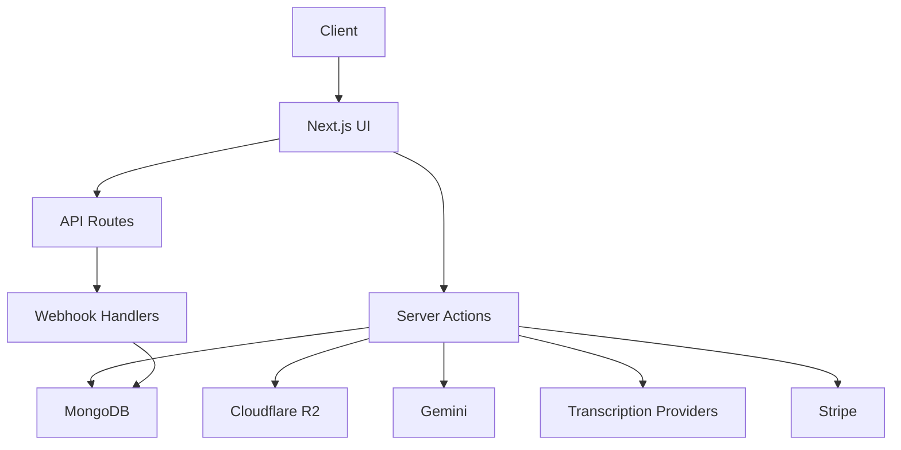

# Architecture

Call Memo is a Next.js 16 App Router application for call recording ingestion, transcription, semantic search, sharing, and billing.

## Stack

- Frontend: Next.js 16, React 19, Tailwind CSS v4, HeroUI
- Backend: Server Actions + API routes
- Database: MongoDB
- Object storage: Cloudflare R2 (S3-compatible)
- Auth: Firebase Auth + Firebase Admin verification
- AI/transcription: Gemini, Soniox, ElevenLabs
- Billing: Stripe subscriptions + metered usage

## High-Level Flow



## Repository Layout

```text
src/
  app/
    actions/            # Primary backend mutations/queries
    api/                # Webhooks, auth, billing, cron, support
    admin/              # Admin routes
  components/           # UI and page components
  lib/
    db/                 # Data access/types/index setup
    stripe/             # Billing sync + usage reporting
    export-processor/   # Export job pipeline
    firebase/           # Firebase admin/client helpers
  services/
    ai/                 # Gemini integration
    transcription/      # Soniox + ElevenLabs adapters
scripts/                # Operational/debug helpers
docs/                   # Maintained project documentation
```

## Core Domains

### 1. Recordings

- Upload path writes files to R2 and metadata to MongoDB.
- R2 key structure is user-partitioned and date-grouped.
- Recordings are managed via Server Actions in `src/app/actions/recordings.ts`.

### 2. Transcription + AI

- Provider abstraction in `src/services/transcription`.
- Long-running workflows complete through webhooks:
  - `POST /api/webhooks/soniox`
  - `POST /api/webhooks/elevenlabs`
- Webhook handlers enforce provider authentication/signature checks.
- Webhook callbacks are correlated with `recordings.externalTranscriptionId` before state or usage updates.
- Transcription webhook processing is idempotent via persisted event state in `transcription_webhook_events`.
- Gemini generates summaries and embeddings for search.

### 3. Search

- Semantic search action: `searchRecordingsAction`.
- Atlas vector index required for embedding search.

### 4. Billing

- Access control + entitlement checks happen server-side.
- Stripe usage sync and meter events are in `src/lib/stripe`.
- Billing webhook endpoint: `POST /api/stripe/webhook`.
- Stripe webhooks are idempotent via persisted `event.id` processing state (`stripe_webhook_events`).
- User billing history is fetched from `GET /api/stripe/invoices`.

### 5. Export + Cleanup Jobs

- Cron routes:
  - `GET /api/cron/process-exports`
  - `GET /api/cron/cleanup-recordings`
- Both require `Authorization: Bearer <CRON_SECRET>`.

## Security Model

- No Edge middleware dependency for auth decisions.
- Sensitive operations verify authenticated user/admin per request.
- Share links are signed tokens using `SHARE_LINK_SECRET` (or `NEXTAUTH_SECRET` fallback).
