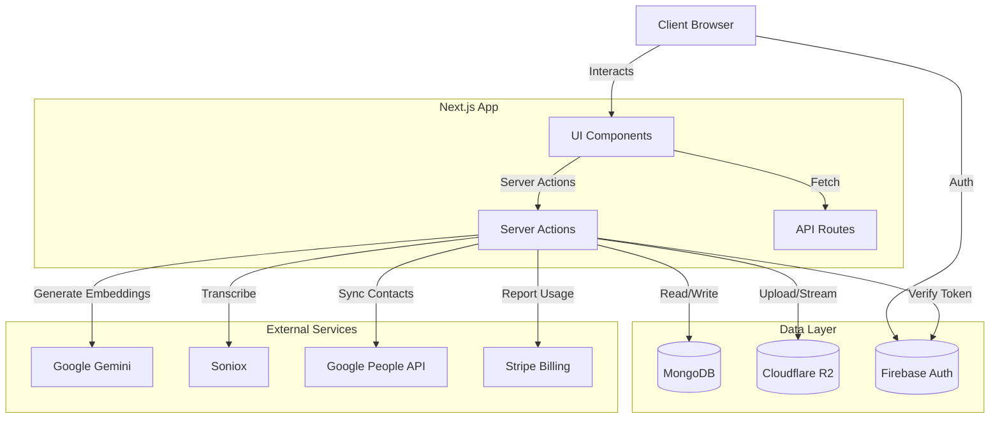

# **App Name**: CallOrganizer

## **Architecture Overview**

CallOrganizer is a modern web application for managing, transcribing, and organizing phone call recordings.

### **Tech Stack**

*   **Frontend**: Next.js 16 (App Router), React 19, HeroUI, Tailwind CSS v4.
*   **Backend**: Next.js Server Actions (primary) & API Routes using a Service Layer pattern.
*   **Database**: MongoDB (via `mongodb` driver) with Vector Search.
*   **Storage**: Cloudflare R2 (S3-compatible object storage) for audio files.
*   **Authentication**: Firebase Auth (Google Sign-In, Anonymous).
*   **AI Services**:
    *   **Google Gemini**: Summarization, Vector Embeddings, and Analysis.
    *   **Soniox**: Transcription and diarization.
*   **External Integrations**:
    *   **Google People API**: Contact synchronization.
    *   **Stripe**: Metered billing and subscriptions.
*   **Notifications**:
    *   **In-App**: MongoDB-backed persistent notifications + Polling/Toasts.
*   **Sharing**:
    *   **JWT Links**: Stateless, signed URLs (`jose`) for secure, time-limited public access without DB state.
*   **PWA**:
    *   **Framework**: Offline-first support via `@ducanh2912/next-pwa`.
    *   **Strategy**: Workbox-powered caching.
        *   **NetworkFirst**: Used for `/api/` routes to ensure fresh data while allowing offline fallback.
        *   **CacheFirst**: Used for Google Fonts and static assets.
        *   **StaleWhileRevalidate**: Used for local images, icons, and `/_next/image` requests.
*   **Monitoring**:
    *   **Sentry**: Full-stack error tracking and performance monitoring.
    *   **Audit Logs**: MongoDB-backed audit trail for administrative actions.

### **System Architecture**

### **Data Storage Strategy**

#### **Cloudflare R2 (Object Storage)**
Files are organized using a hierarchical key structure to optimize for performance and logical grouping.

**Key Pattern**:
`{firebaseUid}/{contactId}/{year}/{month}/{timestamp}_{randomHash}.{extension}`

*   **Partitioning**: Segregated by User ID (`firebaseUid`) for multi-tenancy.
*   **Grouping**: Grouped by Contact ID (or `unknown_{phone}`) for efficient folder browsing.
*   **Time-Series**: Sub-organized by Year/Month to prevent massive single-directory listings.
*   **Uniqueness**: Uses Timestamp + Random Hash to prevent collisions.

### **Service Integration Patterns**

#### **1. Transcription (Soniox)**
*   **Pattern**: Async Polling.
*   **Workflow**:
    1.  **Start**: Server sends audio URL to Soniox (`POST /v1/transcriptions`).
    2.  **Smart Delay**: System waits for ~30% of the audio duration (up to 30s) before the first check, minimizing API chatter.
    3.  **Poll**: Checks status (`GET /v1/transcriptions/{id}`) every 2 seconds.
    4.  **Fetch**: Upon `COMPLETED` status, fetches the full transcript payload.
    5.  **Process**: Reassembles word-level tokens into speaker segments locally.

#### **2. Contact Sync (Google People API)**
*   **Pattern**: Background Batch Processing.
*   **Trigger**: User connects account or manual "Sync Now" action.
*   **Execution**:
    *   Uses `next/after` (or background job) to prevent blocking the UI.
    *   Fetches contacts in batches of 100 via cursor pagination.
    *   Transforms Google resource format to internal `Contact` model.
    *   Performs bulk upserts to MongoDB.

#### **3. Authentication (No Middleware)**
*   **Strategy**: Per-Request Verification.
*   **Reasoning**: Next.js Middleware runs on the Edge, which has limited compatibility with certain Node.js Firebase Admin SDK features.
*   **Implementation**:
    *   **Client**: Firebase Auth handles login and token management.
    *   **Server**: Every Server Action or API Route calls `getUserFromRequest()` or `getFirebaseUidFromSession()`.
    *   **Verification**: Validates the ID Token or Session Cookie against Firebase Admin.

## **Core Features**

1.  **File Ingestion & Storage**:
    *   Direct server-side upload to Cloudflare R2.
    *   Automatic file parsing and renaming.
    *   Organization by contact, year, and month.

2.  **Database & Metadata**:
    *   MongoDB stores metadata for Users, Recordings, and Contacts.
    *   **Vector Search**: Semantic search using MongoDB Atlas Vector Search and Gemini embeddings.

3.  **Transcription & Intelligence**:
    *   Diarized transcription using Soniox.
    *   Semantic search and summarization powered by LLMs (Gemini).
    *   Transliteration and Translation support.

4.  **Contact Management**:
    *   Syncs with Google Contacts.
    *   Auto-links recordings to known contacts.

5.  **User Interface**:
    *   Modern, responsive UI using **HeroUI**.
    *   Data visualization for usage stats.
    *   Advanced search and filtering.

6.  **Admin & Operations**:
    *   **Admin Dashboard**: Insights into system health and storage.
    *   **File Browser**: Direct visual management of stored files.
    *   **Billing Management**: Metered usage tracking (Storage/Transcription).

## **Style Guidelines**

*   **Primary Color**: Deep Blue (#1E3A8A) - Trust & Security.
*   **Background**: Light Gray (#F0F4F8) - Clean & Focus.
*   **Accent**: Electric Purple (#7E57C2) - Highlights & Actions.
*   **Typography**: 'Inter' (Sans-serif).
*   **Design System**: HeroUI & Tailwind CSS.