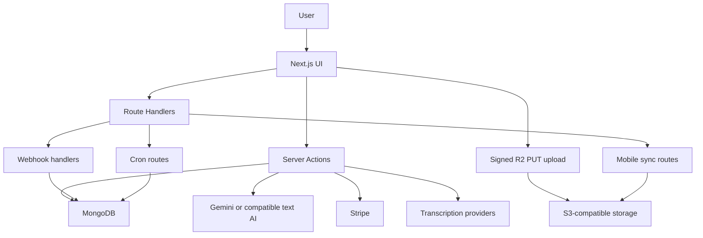

# Architecture

Callery is a Next.js 16 App Router application for ingesting, organizing, transcribing, searching, exporting, and sharing recorded conversations.

## Stack

- Frontend: Next.js 16, React 19, Tailwind CSS v4, HeroUI v3
- Auth: Better Auth + MongoDB for managed and self-hosted deployments, with shared client/server hooks
- Database: MongoDB
- Storage: private S3-compatible storage, including Cloudflare R2, AWS S3, and MinIO
- AI: Gemini or a compatible chat and embedding server
- Transcription: Soniox, ElevenLabs, Gemini, or a compatible Whisper API server
- Billing: Stripe subscriptions, one-time checkout, and metered usage
- Notifications: MongoDB-backed in-app notifications plus optional browser push
- Mobile: archived native wrapper; retained authenticated upload/sync APIs

## High-Level Flow



## Core Application Flows

### Authentication

- Lazy asynchronous `getAuth()` reuses the pooled MongoDB connection; adapter transactions are disabled for standalone servers.
- Better Auth resolves cookie and bearer sessions. Application ownership uses the stable `authSubject` identity.
- Public auth capabilities expose only three booleans without a database connection.
- Google Contacts OAuth is a separate optional integration.
- Server actions and route handlers share identity resolution and reject disabled/deleted profiles.
- Verified bootstrap emails may create admin profiles; other admin access uses MongoDB role checks.

### Direct Uploads

The primary media path is direct to the configured S3-compatible storage:

1. The client asks for upload context and a signed `PUT` URL.
2. The client uploads bytes directly to storage.
3. The app verifies the object through `HeadObject` and checks the uploaded byte size.
4. The app creates the recording document and updates storage usage.
5. If auto-transcription is enabled, the app queues persisted transcription work and wakes the dispatcher with `after(...)`.

This keeps large files off the Next.js request body path and works for both web uploads and Android sync.

### Transcription

Self-hosted deployments support four provider choices:

- Soniox
- ElevenLabs
- Gemini
- compatible Whisper API servers (`openai_compat`)

Managed processing uses the approved Soniox, Gemini, and ElevenLabs models and
weights described in [billing](billing.md).

Important design points:

- upload and transcription are separate steps
- manual, automatic, and approved batch requests enter a persisted MongoDB queue
- one recording pipeline runs at a time across the instance, including work awaiting cloud callbacks
- Soniox and ElevenLabs recordings longer than `300 seconds` use provider callbacks; shorter jobs and the other providers run within the claimed dispatcher attempt
- webhook processing is idempotent through `transcription_webhook_events`, and attempt identities fence stale responses
- weighted transcription usage is reported only once per processing run
- ingestion cron recovers interrupted work; uncertain provider outcomes require explicit review before retry

See [transcription batches](transcription-batches.md) for pause, retry, and enrichment recovery behavior.

### Search And Retrieval

The archive supports:

- standard listing and filtering
- contact-linked browsing
- transcript and summary review
- semantic search backed by embeddings from the configured text AI provider

Embeddings live on the recording document. Atlas vector search support depends on the database indexes and deployment configuration, but the app also exposes fallback mode information in the search action response.

### Exports

Exports are modeled as background jobs:

- `startExport()` reuses an eligible cached archive or creates an `export_jobs` record, with at most one fresh archive per account per 24 hours
- development wakes processing with `after(...)`
- production should use `GET /api/cron/process-exports`
- an atomic worker lease and heartbeat prevent competing workers from publishing checkpoints
- `retryExport()` can resume an eligible failed job within its two-generation-attempt limit, after verifying its source revision and saved parts
- generated parts stay in private S3-compatible storage for seven days after completion, with renewable 15-minute download URLs

Each archive part contains audio, JSON metadata, transcript text files, `README.txt`, and `viewer.html`.

### Post-Response Work

Not all background work is cron-managed:

- transcription is persisted before Next.js `after(...)` wakes the dispatcher; ingestion cron provides recovery
- support email delivery also uses `after(...)` after the support request is accepted
- production export generation waits for scheduled cron pickup; failed jobs require an explicit eligible retry
- billing delivery and reconciliation also retain persisted state and scheduled recovery

### Future mobile clients

The native wrapper is archived. The existing sync-token and direct-upload APIs accept the deployment's own authentication mechanism and remain reusable. See [Android archive](android-app.md).

## Repository Layout

```text
src/
  app/
    actions/            Server Actions
    api/                Auth, billing, cron, filesystem, mobile, support, webhook routes
    admin/              Admin pages
  components/           UI and page components
  hooks/                Client-side hooks
  lib/
    db/                 Collections, types, indexes, init, query helpers
    export-processor/   Export packaging and lifecycle
    auth/               Better Auth configuration, server and client hooks
    stripe/             Customer, sync, and usage reporting logic
    sync-store/         Android sync persistence helpers
  services/
    ai/                 Gemini and compatible text AI integration
    google/             Google Contacts sync and OAuth helpers
    transcription/      Provider abstraction and adapters
docs/                   Maintained docs
scripts/                Operational helper scripts
src/scripts/            Backfill and repair scripts
```

## Security Boundaries

- Upload completion is protected with signed upload session tokens.
- Future sync clients use separately signed, limited sync tokens after instance-native login.
- Public share pages use signed, time-limited tokens.
- Stripe return URLs are forced to same-origin values.
- Provider webhooks require secrets or signature validation.
- Cron routes require `Authorization: Bearer <CRON_SECRET>`.
- Support submissions enforce origin checks, a honeypot field, and IP-based rate limiting.
- Next.js responses include security headers. A Content Security Policy is applied in production, either in enforced mode (`Content-Security-Policy`) or report-only mode (`Content-Security-Policy-Report-Only`) based on the `CSP_REPORT_ONLY` env flag. Vercel preview deployments automatically use report-only mode. The CSP directives and mode logic live in `src/lib/security-headers.ts`.

## Deployment Notes

- The build uses `output: 'standalone'`.
- Server Actions are configured with a `20mb` body limit, but audio uploads avoid that limit through direct R2 uploads.
- Production adds HSTS headers.
- Google login uses `/api/auth/callback/google`; separate Contacts authorization uses `/api/auth/google/callback`.
