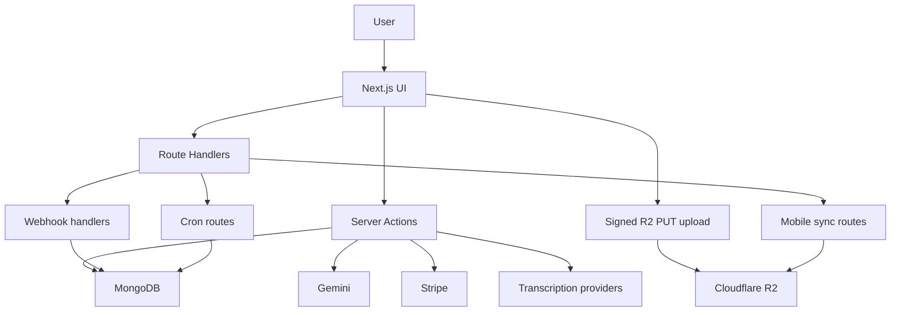

# Architecture

Call Memo is a Next.js 16 App Router application for ingesting, organizing, transcribing, searching, exporting, and sharing recorded conversations.

## Stack

- Frontend: Next.js 16, React 19, Tailwind CSS v4, HeroUI v3 beta
- Auth: Firebase Auth on the client, Firebase Admin-backed session verification on the server
- Database: MongoDB
- Storage: Cloudflare R2
- AI: Gemini
- Transcription: Soniox and ElevenLabs
- Billing: Stripe subscriptions, one-time checkout, and metered usage
- Notifications: MongoDB-backed in-app notifications plus optional browser push
- Mobile: Capacitor Android wrapper with native folder-sync helpers

## High-Level Flow



## Core Application Flows

### Authentication

- Users authenticate through Firebase.
- `/api/auth/login` converts the Firebase identity into a server-side session cookie.
- Protected Server Actions and route handlers resolve the current user from that session.
- Admin access is enforced through role checks against the MongoDB user record.

### Direct Uploads

The primary media path is direct-to-R2:

1. The client asks for upload context and a signed `PUT` URL.
2. The client uploads bytes directly to Cloudflare R2.
3. The app verifies the object through `HeadObject` and checks the uploaded byte size.
4. The app creates the recording document and updates storage usage.
5. If auto-transcription is enabled, the app queues an async job.

This keeps large files off the Next.js request body path and works for both web uploads and Android sync.

### Transcription

The app supports two providers:

- Soniox
- ElevenLabs

Important design points:

- upload and transcription are separate steps
- shorter manual and auto-transcription jobs can complete inline
- recordings longer than `300 seconds` are handed off asynchronously through provider callbacks
- webhook processing is idempotent through `transcription_webhook_events`
- weighted transcription usage is reported only once per processing run

### Search And Retrieval

The archive supports:

- standard listing and filtering
- contact-linked browsing
- transcript and summary review
- semantic search backed by Gemini-generated embeddings

Embeddings live on the recording document. Atlas vector search support depends on the database indexes and deployment configuration, but the app also exposes fallback mode information in the search action response.

### Exports

Exports are modeled as background jobs:

- `startExport()` creates an `export_jobs` record
- development can process inline with `after(...)`
- production should use `GET /api/cron/process-exports`
- generated parts are stored in R2 and exposed as signed downloads

Each archive part contains audio, JSON metadata, transcript text files, `README.txt`, and `viewer.html`.

### Async Job System

The `async_jobs` collection powers queued background work for:

- auto transcription
- Google Contacts sync
- support email delivery

Jobs can be claimed, retried with exponential backoff, marked failed, and retried manually from the admin dashboard. Completed jobs are TTL-cleaned after `30 days`.

### Android Folder Sync

The Android app is a Capacitor wrapper that loads the hosted web app from `capacitor.config.ts`.

Android-specific behavior includes:

- `/android-sync` UI
- a `24h` mobile sync session token route
- mobile direct-upload init and complete routes
- native background sync and folder scan plugins
- local sync state persisted in the device sync store

The web browser version does not expose device-folder scanning.

## Repository Layout

```text
src/
  app/
    actions/            Server Actions
    api/                Auth, billing, cron, filesystem, mobile, support, webhook routes
    admin/              Admin pages
  components/           UI and page components
  hooks/                Client-side hooks
  lib/
    db/                 Collections, types, indexes, init, query helpers
    export-processor/   Export packaging and lifecycle
    firebase/           Client/admin Firebase helpers
    stripe/             Customer, sync, and usage reporting logic
    sync-store/         Android sync persistence helpers
  services/
    ai/                 Gemini integration
    google/             Google Contacts sync and OAuth helpers
    transcription/      Provider abstraction and adapters
android/                Capacitor Android project and native plugins
docs/                   Maintained docs
scripts/                Operational helper scripts
src/scripts/            Backfill and repair scripts
```

## Security Boundaries

- Upload completion is protected with signed upload session tokens.
- Android background sync uses a separate signed mobile-sync token that can outlive a Firebase ID token.
- Public share pages use signed, time-limited tokens.
- Stripe return URLs are forced to same-origin values.
- Provider webhooks require secrets or signature validation.
- Cron routes require `Authorization: Bearer <CRON_SECRET>`.
- Support submissions enforce origin checks, a honeypot field, and IP-based rate limiting.
- Next.js responses include security headers and optional CSP report-only mode.

## Deployment Notes

- The build uses `output: 'standalone'`.
- Server Actions are configured with a `20mb` body limit, but audio uploads avoid that limit through direct R2 uploads.
- Production adds HSTS headers.
- Firebase helper rewrites are only enabled when the helper origin can be resolved from env.
