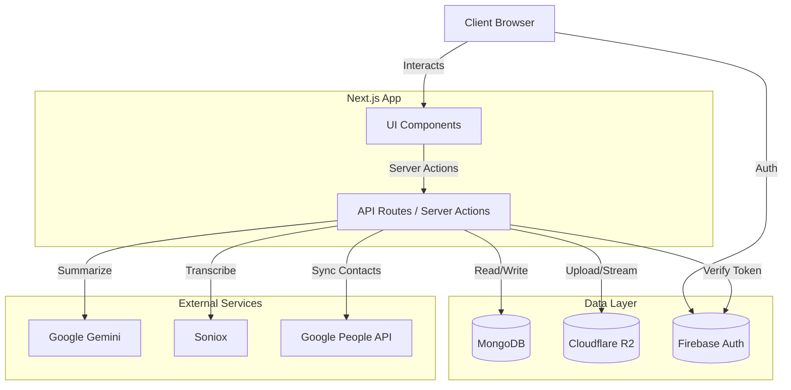

# **App Name**: CallOrganizer

## **Architecture Overview**

CallOrganizer is a modern web application for managing, transcribing, and organizing phone call recordings.

### **Tech Stack**

*   **Frontend**: Next.js 15+ (App Router), React 19, HeroUI, Tailwind CSS v4.
*   **Backend**: Next.js API Routes (Serverless functions).
*   **Database**: MongoDB (via `mongodb` driver).
*   **Storage**: Cloudflare R2 (S3-compatible object storage) for audio files.
*   **Authentication**: Firebase Auth (Google Sign-In, Anonymous).
*   **AI Services**:
    *   **Google Gemini**: Summarization and analysis.
    *   **Soniox**: Transcription and diarization.
*   **External Integrations**:
    *   **Google People API**: Contact synchronization.

### **System Architecture**

## **Core Features**

1.  **File Ingestion & Storage**:
    *   Direct upload to Cloudflare R2 using presigned URLs.
    *   Automatic file parsing and renaming.
    *   Organization by contact, year, and month.

2.  **Database & Metadata**:
    *   MongoDB stores metadata for Users, Recordings, and Contacts.
    *   Efficient indexing for search and retrieval.

3.  **Transcription & Intelligence**:
    *   Diarized transcription using Soniox.
    *   Semantic search and summarization powered by LLMs (Gemini).

4.  **Contact Management**:
    *   Syncs with Google Contacts.
    *   Auto-links recordings to known contacts.

5.  **User Interface**:
    *   Modern, responsive UI using **HeroUI**.
    *   Data visualization for usage stats.
    *   Advanced search and filtering.

6.  **Admin & Operations**:
    *   **Admin Dashboard**: Insights into system health and storage.
    *   **File Browser**: Direct visual management of stored files.
    *   **Manual Upload**: Web-based upload tool.

## **Style Guidelines**

*   **Primary Color**: Deep Blue (#1E3A8A) - Trust & Security.
*   **Background**: Light Gray (#F0F4F8) - Clean & Focus.
*   **Accent**: Electric Purple (#7E57C2) - Highlights & Actions.
*   **Typography**: 'Inter' (Sans-serif).
*   **Design System**: HeroUI & Tailwind CSS.