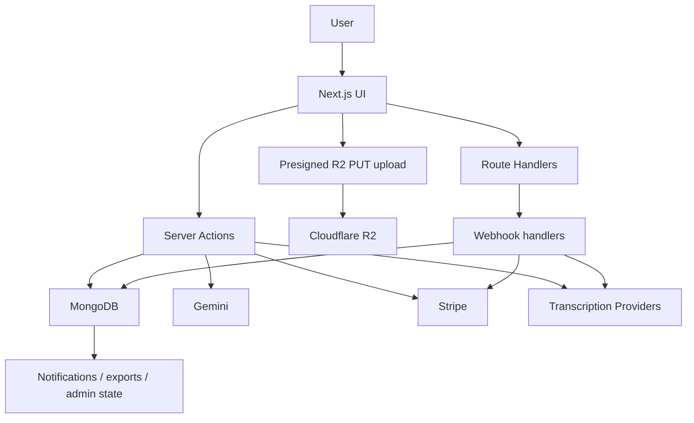

# Architecture

Call Memo is a Next.js 16 App Router application for ingesting, organizing, transcribing, searching, and sharing recorded conversations.

## Stack

- Frontend: Next.js 16, React 19, Tailwind CSS v4, HeroUI v3 beta
- Backend: Server Actions plus route handlers
- Auth: Firebase Auth on the client, Firebase Admin verification on the server
- Database: MongoDB
- Storage: Cloudflare R2
- AI: Gemini
- Transcription: Soniox and ElevenLabs
- Billing: Stripe subscriptions and metered usage
- Notifications: MongoDB-backed in-app notifications, optional browser push, optional SMTP forwarding
- Mobile wrapper: Capacitor Android

## High-Level Flow



## Main Product Areas

### Upload And Storage

- The primary upload path is a direct-to-R2 flow.
- The client requests a signed PUT URL.
- The client uploads bytes directly to R2.
- The app finalizes the upload, verifies the object, writes recording metadata, and can trigger transcription.

Why it matters:

- Large files bypass app-server request body limits.
- The same storage path works for browser and Android upload workflows.

### Recordings Workspace

The recordings area combines:

- paginated listing
- filters and sorting
- semantic search
- saved views in local storage
- smart collections
- playback
- transcript review
- sharing

It is the main operational surface for end users.

### Contacts

Contacts are stored in MongoDB and can be synced from Google People API. The app keeps aggregate stats such as total recordings and last recording date so the contacts view can act like a relationship-centric index into the recording library.

### AI And Search

Gemini is used for:

- short English summaries
- transliteration output
- embeddings for semantic search

Semantic search relies on stored embeddings and an Atlas vector index. If Gemini is not configured, the app still works, but AI-dependent features degrade gracefully.

### Transcription

The transcription subsystem is provider-based:

- Soniox
- ElevenLabs

Core design points:

- upload and transcription are separate steps
- provider callbacks arrive asynchronously through webhooks
- callbacks are matched against `externalTranscriptionId`
- webhook processing is idempotent

### Billing

Billing is feature-flagged with `NEXT_PUBLIC_ENABLE_BILLING`.

When enabled, the app supports:

- plan documents stored in MongoDB
- Stripe Checkout for upgrades
- Stripe Customer Portal
- metered storage usage
- metered transcription usage
- overage toggles at the user level

### Notifications And Support

Notifications are stored in MongoDB and surfaced in the UI. Optional browser push uses VAPID keys. Support requests are saved to MongoDB and optionally forwarded via SMTP.

## Repository Layout

```text
src/
  app/
    actions/            # Server Actions for product and admin flows
    api/                # Auth, billing, webhooks, support, cron, filesystem
    admin/              # Admin routes
  components/           # UI components and page-level surfaces
  hooks/                # Client-side data and settings hooks
  lib/
    db/                 # Mongo data access, types, init, indexes
    stripe/             # Billing sync and usage reporting
    firebase/           # Firebase client and admin helpers
    export-processor/   # Export job lifecycle
  services/
    ai/                 # Gemini integration
    google/             # Contacts sync + OAuth helpers
    transcription/      # Provider abstraction and adapters
docs/                   # Maintained docs
scripts/                # Operational helper scripts
src/scripts/            # Data-fix and backfill scripts
android/                # Capacitor Android project
```

## Security Model

- Auth decisions are made server-side per request or action.
- Upload finalization is protected by signed upload session tokens.
- Public share links are signed and time-limited.
- Provider webhooks require shared-secret or signature verification.
- Stripe webhooks are verified and processed idempotently.
- Admin capabilities are role-gated.

## Async Workflows

Important background-style flows in the app:

- transcription provider callbacks
- export processing
- retention cleanup
- Stripe webhook synchronization
- notification delivery

These flows are why MongoDB indexes, cron routes, and webhook configuration are part of normal setup rather than optional polish.
