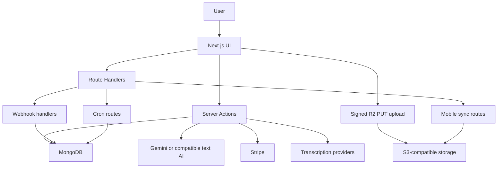

# Architecture

Callery is a Next.js 16 App Router application for ingesting, organizing, transcribing, searching, exporting, and sharing recorded conversations.

## Stack

- Frontend: Next.js 16, React 19, Tailwind CSS v4, HeroUI v3 beta
- Auth: deployment-selected local Better Auth or Firebase, with a shared client/server auth seam
- Database: MongoDB
- Storage: Cloudflare R2
- AI: Gemini
- Transcription: Soniox and ElevenLabs
- Billing: Stripe subscriptions, one-time checkout, and metered usage
- Notifications: MongoDB-backed in-app notifications plus optional browser push
- Mobile: archived native wrapper; retained authenticated upload/sync APIs

## High-Level Flow



## Core Application Flows

### Authentication

- `AUTH_PROVIDER` and build-time `NEXT_PUBLIC_AUTH_PROVIDER` select local Better Auth or Firebase.
- Local auth stores identities and sessions in MongoDB; Firebase mode verifies Firebase ID tokens/session cookies.
- Google Contacts OAuth is a separate optional integration.
- Server actions and route handlers share identity resolution and reject disabled/deleted profiles.
- Verified bootstrap emails may create admin profiles; other admin access uses MongoDB role checks.

### Direct Uploads

The primary media path is direct-to-R2:

1. The client asks for upload context and a signed `PUT` URL.
2. The client uploads bytes directly to Cloudflare R2.
3. The app verifies the object through `HeadObject` and checks the uploaded byte size.
4. The app creates the recording document and updates storage usage.
5. If auto-transcription is enabled, the app starts post-response transcription work with `after(...)`.

This keeps large files off the Next.js request body path and works for both web uploads and Android sync.

### Transcription

The app supports two providers:

- Soniox
- ElevenLabs

Important design points:

- upload and transcription are separate steps
- shorter manual and auto-transcription jobs can complete inline
- recordings longer than `300 seconds` are handed off asynchronously through provider callbacks
- webhook processing is idempotent through `transcription_webhook_events`
- weighted transcription usage is reported only once per processing run

### Search And Retrieval

The archive supports:

- standard listing and filtering
- contact-linked browsing
- transcript and summary review
- semantic search backed by Gemini-generated embeddings

Embeddings live on the recording document. Atlas vector search support depends on the database indexes and deployment configuration, but the app also exposes fallback mode information in the search action response.

### Exports

Exports are modeled as background jobs:

- `startExport()` creates an `export_jobs` record
- development can process inline with `after(...)`
- production should use `GET /api/cron/process-exports`
- generated parts are stored in R2 and exposed as signed downloads

Each archive part contains audio, JSON metadata, transcript text files, `README.txt`, and `viewer.html`.

### Post-Response Work

Not all background work is cron-managed:

- auto-transcription starts with Next.js `after(...)` after upload finalization
- support email delivery also uses `after(...)` after the support request is accepted
- exports remain the only job model that waits for scheduled cron pickup in production

### Future mobile clients

The native wrapper is archived. The existing sync-token and direct-upload APIs accept the deployment's own authentication mechanism and remain reusable. See [Android archive](android-app.md).

## Repository Layout

```text
src/
  app/
    actions/            Server Actions
    api/                Auth, billing, cron, filesystem, mobile, support, webhook routes
    admin/              Admin pages
  components/           UI and page components
  hooks/                Client-side hooks
  lib/
    db/                 Collections, types, indexes, init, query helpers
    export-processor/   Export packaging and lifecycle
    firebase/           Client/admin Firebase helpers
    stripe/             Customer, sync, and usage reporting logic
    sync-store/         Android sync persistence helpers
  services/
    ai/                 Gemini integration
    google/             Google Contacts sync and OAuth helpers
    transcription/      Provider abstraction and adapters
docs/                   Maintained docs
scripts/                Operational helper scripts
src/scripts/            Backfill and repair scripts
```

## Security Boundaries

- Upload completion is protected with signed upload session tokens.
- Future sync clients use separately signed, limited sync tokens after instance-native login.
- Public share pages use signed, time-limited tokens.
- Stripe return URLs are forced to same-origin values.
- Provider webhooks require secrets or signature validation.
- Cron routes require `Authorization: Bearer <CRON_SECRET>`.
- Support submissions enforce origin checks, a honeypot field, and IP-based rate limiting.
- Next.js responses include security headers. A Content Security Policy is applied in production, either in enforced mode (`Content-Security-Policy`) or report-only mode (`Content-Security-Policy-Report-Only`) based on the `CSP_REPORT_ONLY` env flag. Vercel preview deployments automatically use report-only mode. The CSP directives and mode logic live in `src/lib/firebase-auth-helper-config.ts`.

## Deployment Notes

- The build uses `output: 'standalone'`.
- Server Actions are configured with a `20mb` body limit, but audio uploads avoid that limit through direct R2 uploads.
- Production adds HSTS headers.
- Firebase helper rewrites are only enabled when the helper origin can be resolved from env.
